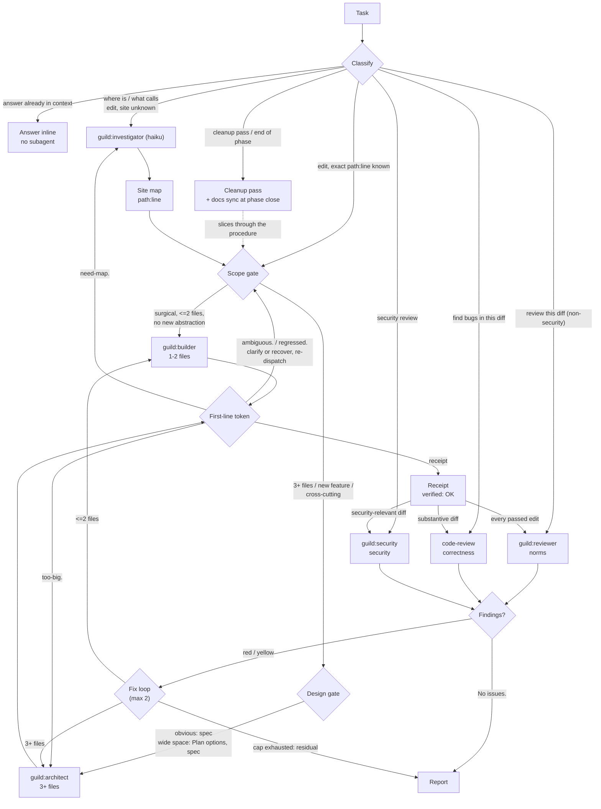

<p align="center"></p>

# guild

A project-agnostic Claude Code plugin that routes coding work through a crew of specialist agents.

## Contents

- [What it is](#what-it-is)
- [The DAG](#the-dag)
- [Install](#install)
- [Adopting in a project](#adopting-in-a-project)
- [Requirements](#requirements)
- [Layout](#layout)
- [Configuration](#configuration)
- [Model and effort per agent](#model-and-effort-per-agent)
- [Git handling (opt-in)](#git-handling-opt-in)
- [Hooks](#hooks)
- [What the plugin runs, reads and writes](#what-the-plugin-runs-reads-and-writes)
- [Priority facts](#priority-facts)
- [Non-goals](#non-goals)

## What it is

This section summarizes what the plugin ships and how its agents are tiered. It is a project-agnostic delegation crew for Claude Code. It ships:

- **Six agents:** `guild:investigator`, `guild:builder`, `guild:architect`, `guild:reviewer`, `guild:security`, `guild:scribe`.
- **Default procedure:** `context/procedure.md`, injected at session start, so every coding request walks the delegation DAG without a slash command: classify, investigate, scope gate, design gate, implement, review, report.
- **DAG rules:** `skills/guild/DAG.md` carries the node rules, dispatch modes, cleanup-pass and docs-sync procedures and the parallel-wave contracts.
- **Forced walk:** `/guild <task>` only forces the walk on a request that looks trivial.
- **Hooks:** POSIX sh, each with a PowerShell twin for Windows machines without Git Bash. They cover always-on context injection at session start, per-prompt reinforcement, an emoji scan on every file edit, and a subagent receipt-contract check.
- **Opt-in git handling:** a generic `git` skill plus a guard hook that denies AI attribution, `--no-verify` and forced pushes (see Git handling).
- **Switches:** every hook and the optional procedure steps can be turned off per user or per project (see Configuration).
- **Two workflows:** for the review and cleanup-pass waves.
- **Charter convention:** a per-project charter.

Project knowledge never lives in the plugin. It lives in `<project>/.claude/guild.md` (the charter), which every agent reads first.

Models are pinned per agent (the shipped defaults; see Model and effort per agent to change them):

| Agent | Model |
|---|---|
| `guild:investigator` | haiku |
| `guild:builder` | opus |
| `guild:architect` | opus |
| `guild:reviewer` | opus |
| `guild:security` | fable (never downgraded) |
| `guild:scribe` | sonnet |

The rationale is cost tiering (cheap scouting, mid-cost implementation, the strongest model only for security and orchestration) and wall-clock parallelism, not context saving.

## The DAG

This section shows the graph every coding request walks; the full flowchart with every edge and terminal token is in `skills/guild/DAG.md`.



## Install

This section covers getting the plugin onto a machine and enabling it.

Local path, for development:

```bash
claude plugin marketplace add <path to your checkout>
```

Then, inside Claude Code:

```
/plugin install guild@guild
```

From GitHub, once pushed:

```bash
claude plugin marketplace add NatalJR/guild
```

Enable in `~/.claude/settings.json`:

```json
{
  "enabledPlugins": { "guild@guild": true }
}
```

Update with `/plugin update guild`.

## Adopting in a project

This section lists the steps that connect a project to the guild.

1. **Copy the charter.** Copy `charter/TEMPLATE.md` to `<project>/.claude/guild.md` and fill every section (`charter/SCHEMA.md` defines each one).
2. **Point at it.** Point the project's root `CLAUDE.md` at the charter with one line.
3. **Keep rules scoped.** Keep project-specific rules in `.claude/rules/*.md` with `paths:` frontmatter, and list them in the charter's Rules section.
4. **Choose git handling.** Keep the project's own `git` skill or conventions and leave git handling off, or turn it on to use the guild `git` skill and guard instead (see Git handling).
5. **Remove collisions.** Delete any project-local agents or skills whose names collide with the plugin's. Project agents shadow plugin agents, and user skills shadow project skills.

## Requirements

This section states what a machine needs to run the hooks.

- **Primary runtime:** POSIX sh: dash or bash on Linux and macOS, Git Bash's sh on Windows. That is the same requirement as the Claude Code Bash tool, so any machine that runs Claude Code already has it.
- **Nothing else:** the sh hooks use only the standard utilities that ship with that shell (`cat`, `sed`, `grep -E`, `tr`, `cut`, `head`, `sort`, `wc`, `mv`, `rm`), and no `jq`, `node` or `python`.

Windows without Git Bash:

- **Automatic twin:** Claude Code runs hook commands through PowerShell, and each hook entry then runs the PowerShell 7 twin of its script (`hooks/<script>.ps1`, also valid Windows PowerShell 5.1 syntax) automatically; there is nothing to configure.
- **Same behaviour:** the twins use only PowerShell and .NET, read the same switches, and produce the same stdout, stderr and exit codes as the sh scripts; both implementations run the shared cases in `tests/cases/`.
- **PowerShell 7 needed:** the fallback needs PowerShell 7 (`pwsh`) installed, which the harness prefers over Windows PowerShell.
- **Harmless error:** on that path the first line of each hook command (`exec sh ...`) prints a harmless `exec is not recognized` error to stderr before the twin runs (see Hooks).

## Layout

This section maps the files in the repository.

```
.claude-plugin/plugin.json      plugin manifest
.claude-plugin/marketplace.json local marketplace entry
.claude/guild.md                charter of this repository (verify commands, areas, rules)
agents/                         the six agent definitions
skills/guild/                   DAG.md (binding rules) + the /guild force-the-walk skill
skills/git/                     generic git workflow skill, active only with git handling on
hooks/                          hooks.json + the sh hook scripts and their .ps1 PowerShell twins
hooks/lib/                      shared libraries (sh, each with a .ps1 twin): payload field access, switch table
hooks/render-agents.sh          renders the per-agent model and effort options into agents/*.md frontmatter
hooks/render-agents.ps1         PowerShell twin of render-agents.sh
hooks/check-context-size.sh     maintenance check: each rendered context part under 9000 bytes
config/defaults.conf            switch defaults, one commented line per key
context/always-on.md            style + universal rules, injected at session start
context/procedure.md            default operating procedure (the DAG walk), injected at session start
charter/SCHEMA.md               charter contract (headings, consumers, content)
charter/TEMPLATE.md             blank charter to copy into a project
workflows/cleanup-audit.js      /guild:cleanup-audit: cleanup-pass audit wave; allow rule Workflow(cleanup-audit)
workflows/review-wave.js        /guild:review-wave: pre-commit review wave over one diff; allow rule Workflow(review-wave)
tests/run.sh                    hook contract suite (sh tests/run.sh), fixtures under tests/fixtures/
tests/run.ps1                   the same contract for the PowerShell twins (pwsh -NoProfile -File tests/run.ps1)
tests/cases/                    payload-driven cases shared by both runners, one file per hook (format in each file)
LICENSE                         license
.gitattributes                  LF line endings for every text file (sh breaks on CRLF)
```

## Configuration

This section explains how to turn hooks and procedure steps on or off per user or per project. Every switch is on by default.

Three files are read in order, and a later file wins (git handling is not a switch in these files: the plugin option is its only control, see Git handling):

1. `<plugin root>/config/defaults.conf`: the shipped defaults; it also declares the known keys.
2. `~/.claude/guild.conf`: user overrides.
3. `<project>/.claude/guild.conf`: project overrides.

Grammar:

- **Line form:** one `key = value` per line, spaces around `=` optional.
- **Values and keys:** values are `on`, `off`, `true`, `false`, `yes` or `no`, in any case; keys are lowercase, exactly as listed below.
- **Comments:** blank lines and lines starting with `#` are comments.
- **Ignored silently:** a malformed line (a trailing `# comment` after the value included), a key the defaults file does not declare, and a missing file.
- **Never executed:** values are only matched against that grammar, never expanded or executed.

Reporting and fallbacks:

- **Changed-switch report:** when any switch differs from its shipped default, the always-on context ends with a `## Guild switches changed` section listing each such switch as `key=value`, comma separated (for example `git.handling=on, review.security=off`), so the session knows what departs from the defaults; with the shipped defaults the section is absent.
- **Missing defaults file:** if `config/defaults.conf` is missing, every key reads as on except `git.handling`, which stays off unless the plugin option turns it on.
- **Templated text:** the `procedure.*`, `review.*` and `docs.sync` switches remove the matching text from the injected procedure, and `git.handling` picks the Step 6 commit sentence; `skills/guild/DAG.md` itself is not templated.

The workflows (`workflows/*.js`) ignore the review switches: they always run every dimension they define. With a review switch off, pass only the dimensions you want through the main thread, which dispatches them itself instead of running the workflow.

Find the key you want to change in the first column; the last column says what you lose when it is set to off.

| Key | Default | Effect of off |
|---|---|---|
| `style.terse` | on | Drops `## Reply style` (terse replies, length budget) from the always-on context |
| `rules.universal` | on | Drops `## Universal code rules` from the always-on context |
| `procedure.default_mode` | on | The procedure is not injected at session start; `/guild <task>` reads `context/procedure.md` on demand |
| `procedure.investigate_first` | on | The architect may be dispatched without an investigator site map |
| `procedure.design_gate` | on | Drops Step 3a (vanilla `Plan` options on the architect route) |
| `procedure.sharding` | on | Work over 12 files or more than one area is no longer forced into parallel slices |
| `procedure.cleanup_pass` | on | Drops the cleanup pass route and section |
| `review.norms` | on | No `guild:reviewer` pass on every passed edit |
| `review.correctness` | on | No `code-review` skill pass on substantive diffs |
| `review.security` | on | No `guild:security` diff gate; security-relevant diffs ship without a security review |
| `docs.sync` | on | Drops the DAG.md `## Docs sync` step at phase close |
| `hooks.prompt_reinforce` | on | No per-prompt reinforcement line |
| `hooks.emoji_scan` | on | Emoji in written files are no longer rejected |
| `hooks.receipt_check` | on | Guild subagents may stop without a terminal token on line 1 |

Example, `<project>/.claude/guild.conf` for a project whose security review and emoji policy live elsewhere:

```
# Security review runs outside the guild for this project.
review.security = off
# Emoji are allowed in this project's files.
hooks.emoji_scan = off
```

## Model and effort per agent

This section explains how to change each agent's model and reasoning effort. They are plugin options, not `guild.conf` switches.

- **Option names:** `investigator_model`, `investigator_effort`, `builder_model`, `builder_effort`, `architect_model`, `architect_effort`, `reviewer_model`, `reviewer_effort`, `security_model`, `security_effort`, `scribe_model`, `scribe_effort`.
- **Allowed values:** a model is one of `haiku`, `sonnet`, `opus`, `fable` or `inherit` (the session's model); an effort is one of `low`, `medium`, `high`, `xhigh` or `max`.
- **Defaults:** the shipped agent frontmatter: the models in the table above, effort `high` for the architect, reviewer and security agents and `medium` for the rest.
- **Security agent:** the guild never downgrades `guild:security`; lowering its options is your call.

How a change takes effect:

- **Where to set:** Claude Code shows the options in the prompt when the plugin is installed and later in `/config`, and passes them to the hooks as `CLAUDE_PLUGIN_OPTION_<AGENT>_MODEL` and `CLAUDE_PLUGIN_OPTION_<AGENT>_EFFORT`.
- **Rendering:** a change is rendered on the next prompt (and at every session start) by `hooks/render-agents.sh`: when an option holds an allowed value that differs from the `model:` or `effort:` line in `<plugin root>/agents/<agent>.md`, that frontmatter line is rewritten in place and nothing else in the file changes.
- **Notice and reload:** the hook then prints `GUILD AGENTS RENDERED: <agent> model=<m> effort=<e>; ... Run /reload-plugins to apply.`; run `/reload-plugins` to load the rewritten agents in the current session.
- **Safe failure:** an unset or unknown value is ignored, and the hook writes nowhere outside `agents/`. An agent whose rewrite fails is skipped, the others still render, and the notice lists only the agents rendered.
- **Workflows:** the workflows pass no effort to `guild:*` agents, so these options also hold inside a workflow; only the default correctness agent of `review-wave` takes the workflow's `effort` argument.

Effect on a checkout:

- **Modified files in git:** the rewrite happens in the installed copy of the plugin. With a directory-source install (a local checkout added as the marketplace, as in Install above), that copy is the checkout itself, so while any option differs from its default the rewritten agent files show as modified in git.
- **Keep out of commits:** keep those lines out of commits; the render cases in `tests/` expect the shipped frontmatter, so run the suites with the options at their defaults.

## Git handling (opt-in)

This section explains the optional git conventions and guard the plugin can enforce.

Off by default. While it is off, nothing git-related from the guild applies:

- the git guard hook exits without checking;
- the `git` skill stops at its first line;
- Step 6 of the procedure routes commits through the project's own git skill or conventions named under the charter's `## Git`.

On, three things change:

- **Git skill:** `skills/git/SKILL.md` applies: Conventional Commits, one commit per logical change, no AI attribution, no push without an explicit request, a linear rebase-and-PR flow, and a short forbidden list. It is invoked before any commit, push, branch, rebase or PR.
- **Step 6:** Step 6 of the injected procedure routes commits through that skill.
- **Guard hook:** `hooks/git-guard.sh` checks every `Bash` and `PowerShell` command, compound commands included, and denies:
  - AI attribution (`Co-Authored-By`, `Generated with`, `Claude Code`, `Anthropic`, `noreply@anthropic.com`) in `git commit` and `gh pr create` / `gh pr edit`;
  - a hook bypass: `--no-verify` on `git commit` or `git push`, and `-n` on `git commit` (`git push -n` is a dry run and stays allowed);
  - a forced push: `--force` or `-f` on `git push`; `--force-with-lease` and `--force-if-includes` stay allowed.

  The guard reads the command text only: flags inside quoted spans, bundled short flags (`-nm`), `+branch` refspecs, git options before the subcommand, and attribution supplied through files or environment variables are not detected.

How to enable it:

- **Prompt or config:** answer the prompt Claude Code shows when the plugin is enabled, or change "Git handling" later in `/config`.
- **Option plumbing:** Claude Code passes the option to the hooks as `CLAUDE_PLUGIN_OPTION_GIT_HANDLING` and into the skill as `${user_config.git_handling}`.
- **Only switch:** the plugin option is the only switch: a `git.handling` line in any `guild.conf`, the shipped defaults included, is ignored.

## Hooks

This section documents how hook entries are launched and what each hook does.

Every entry is a two-line sh/PowerShell polyglot, so one `hooks.json` serves both shells with no `shell` field:

```
exec sh "${CLAUDE_PLUGIN_ROOT}/hooks/<script>.sh" [part]
& "${CLAUDE_PLUGIN_ROOT}/hooks/<script>.ps1" [part]; exit $LASTEXITCODE
```

How the polyglot runs:

- **Shell choice:** Claude Code hands a hook command to `sh` on Linux and macOS and through Git Bash on Windows when it finds it; otherwise it uses PowerShell.
- **Under sh:** `exec` replaces the shell with the sh script, so the second line is never read.
- **Under PowerShell:** `exec` is not a command: the first line fails with a non-terminating error and the second line runs the PowerShell twin and exits with its status.
- **Twins:** the table names the sh scripts; each `.ps1` twin behaves the same.
- **Library paths:** every hook script resolves its shared libraries through `${CLAUDE_PLUGIN_ROOT}` only (`${CLAUDE_PLUGIN_ROOT}/hooks/lib/` in sh, `$env:CLAUDE_PLUGIN_ROOT\hooks\lib\` in PowerShell), never from its own location; when the variable is unset or a library is missing, the hook prints nothing and exits 0.

Read the table by event: each row is one hook entry, with what it does, how it exits and which switch controls it.

| Event | Script | What it does | Exit behaviour | Switch |
|---|---|---|---|---|
| SessionStart | `session-context.sh context/always-on.md` | Injects the style and universal rules (sections dropped per switch), plus a `## Guild switches changed` list when any switch differs from its shipped default | Exit 0; never blocks | `style.terse`, `rules.universal` |
| SessionStart | `session-context.sh context/procedure.md` | Injects the default operating procedure with the plugin root substituted; prints nothing when the default mode is off | Exit 0; never blocks | `procedure.default_mode` and the procedure switches |
| SessionStart | `render-agents.sh` | Renders the per-agent model and effort options into the agent frontmatter; prints the `GUILD AGENTS RENDERED` notice only when a file changed | Exit 0; never blocks | none (the `<agent>_model` / `<agent>_effort` plugin options) |
| UserPromptSubmit | `prompt-reinforce.sh` | Per-prompt reinforcement line: six-line reply budget, universal code rules, procedure walk | Exit 0; never blocks | `hooks.prompt_reinforce` |
| UserPromptSubmit | `render-agents.sh` | Same render as at session start, so an option changed in `/config` applies on the next prompt | Exit 0; never blocks | none (the plugin options) |
| PreToolUse (`Bash`, `PowerShell`) | `git-guard.sh` | Denies AI attribution in `git commit` and `gh pr create` / `gh pr edit`, a hook bypass (`--no-verify`; `-n` on `git commit`) and a forced push (`--force`, `-f`; `--force-with-lease` allowed) | Exit 2 with the reason on stderr on a match; exit 0 otherwise and whenever the switch is off | `git.handling` (plugin option only) |
| PostToolUse (`Edit`, `Write`) | `emoji-scan.sh` | Scans the written file (inside the project, non-binary) for emoji | Exit 2 naming the first hit line, reported to the agent; exit 0 otherwise | `hooks.emoji_scan` |
| SubagentStop | `receipt-check.sh` | Checks the receipt contract (first-line terminal token) on `guild:*` agents | Exit 2 blocks the stop once on a malformed receipt; allows otherwise | `hooks.receipt_check` |

Notes on the table:

- **One entry per part:** SessionStart has one entry per context part because the harness caps a single hook's stdout near 10KB and replaces anything larger with a 2KB preview.
- **Size check:** `sh hooks/check-context-size.sh` (a maintenance check, not a hook) renders each part with the shipped defaults and fails when any part exceeds 9000 bytes.
- **Never blocks on error:** a malformed payload or an internal error never blocks: the hook prints nothing and exits 0.
- **Tests:** `sh tests/run.sh` is the contract suite for all of the above; `pwsh -NoProfile -File tests/run.ps1` runs the same shared cases from `tests/cases/`, plus its own coded cases, against the PowerShell twins.

## What the plugin runs, reads and writes

This section is the plugin's footprint statement: what executes, what it touches and what it never does.

- **Runs:** six hook scripts, each a POSIX sh script with a PowerShell twin, and nothing else on its own.
- **Launched by the harness:** `session-context` and `render-agents` at SessionStart, `prompt-reinforce` and `render-agents` at UserPromptSubmit, `git-guard` at PreToolUse on `Bash` and `PowerShell`, `emoji-scan` at PostToolUse on `Edit` and `Write`, and `receipt-check` at SubagentStop.
- **No launcher:** each command names its script by the full `${CLAUDE_PLUGIN_ROOT}` path (see Hooks); there is no package launcher, no install step, and no interpreter other than sh or PowerShell.
- **Reads:** the tool-call payload on stdin; `config/defaults.conf` inside the plugin; `~/.claude/guild.conf` and `<project>/.claude/guild.conf` when present; the file just written, for the emoji scan, only when it lies inside the project directory; the plugin's own `agents/*.md`; the `CLAUDE_PLUGIN_OPTION_*` variables the harness exports for the plugin's options.
- **Writes:** only `agents/<name>.md` frontmatter lines inside the plugin folder, through the option render hook, with values restricted to the allowlists in Model and effort per agent. Nothing under the user's home, nothing in the project.
- **Sends and fetches:** nothing. No network access of any kind, no telemetry, no credentials read.
- **Personal data:** none read or stored.
- **Workflows:** run only when invoked by name, through the Claude Code Workflow tool, with the agents' own permissions.

## Priority facts

This section records which definition wins when the same name exists at several levels.

- Agents: project > user > plugin.
- Skills: user > project.
- Hooks merge across levels; none replaces another.

## Non-goals

This section lists what the plugin deliberately does not do.

- No telemetry.
- No gateway or proxy.
