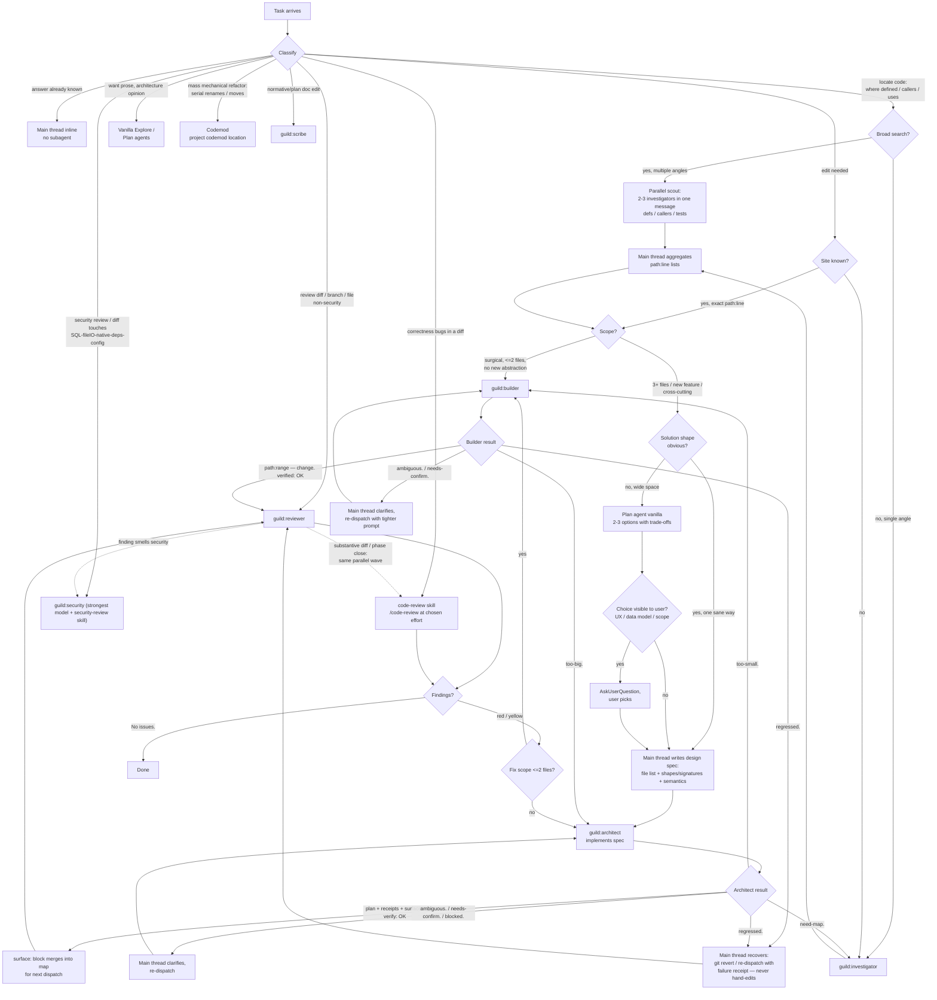

# Guild delegation DAG

Decision graph: when the main thread delegates to `guild:` subagents vs works inline. The walk order is the `## Operating procedure (default mode)` injected into every session (`context/procedure.md`); `/guild <task>` (`SKILL.md` beside this file) only forces that walk on a trivial-looking request. Charter: `<project>/.claude/guild.md`. Project nouns (commands, areas, tracker, QA limits, forbidden operations, doc map, git conventions) live in its sections; this file names the section, never the noun.

## Node rules

- **inline**: one-line answers, facts already in context. Subagent = waste.
- **investigator** (`guild:investigator`): read-only locator. Returns `path:line` tables under `Defs:` / `Refs:` / `Callers:` / `Tests:` / `Sites:`, or `No match.` Never suggests fixes.
- **builder** (`guild:builder`): needs exact site. Receipt `path:range — change.` + `verified:`. Terminal first tokens: `too-big.` / `needs-confirm.` / `ambiguous.` / `regressed.` — each has an edge above, never retry verbatim.
- **design** (vanilla `Plan` agent, read-only, prose output): fires only when the solution space is wide. Seeded with the investigator map verbatim — reads mapped files, no broad re-search, explores only gaps. Returns 2-3 options with trade-offs plus a `new sites:` list that merges into the map before architect dispatch. Choice visible to user (UX, data model, scope) → user picks via AskUserQuestion; internal-only → main thread picks. Winner compressed into the architect spec. Skipped when the shape is obvious. Escape hatch: want output in 1/3 tokens = guild; want prose or rationale = vanilla.
- **architect** (`guild:architect`): inverse of builder — big-scope IMPLEMENTER, not designer. 3+ files, new features, new files, cross-file refactors. The dispatch spec carries the design (file list, shapes/signatures, semantics) AND the work plan. Bash for the `## Verify` commands only. Returns `plan:` ... `verify:` (+ `surface:` block of new public signatures, fed forward) or terminal tokens `too-small.` / `need-map.` / `ambiguous.` / `needs-confirm.` / `regressed.` / `blocked.` Model pins live in the agent files: `guild:security` runs on the strongest model and is never overridden down; the reviewer and architect run on opus by definition.
- **no mega-agent / sharding rule**: big work NEVER becomes one long-running agent — shard into PARALLEL dispatches with exclusive file ownership declared in each prompt ("do not touch X — a concurrent slice owns it"). Applies even to single-concern tasks when the volume is large. Heuristic: >12 files OR >1 area of the `## Areas` map → shard by area and dispatch everything in one message. Collision spotted too late → SendMessage course-corrects the in-flight agent (skipped items become a residual slice).
- **work-plan contract** (every architect dispatch MUST carry it):
  1. **One concern per slice.** Multi-concern work is sliced by the main thread FIRST; the slice plan (1a/1b/1c, each independently verifiable, `surface:` feeding the next) is design output.
  2. **Scope ceiling ~12 files** created/edited per dispatch. Spec exceeding it → slice again before dispatching, not after it stalls.
  3. **Read manifest**: exact paths the architect may Read, target <=10. A category ("read the persistence types") is a spec bug — enumerate. Beyond the manifest → `need-map.`, never self-expansion. **Sanctioned exception**: mechanical FALLOUT of a spec'd change (callers of a renamed symbol, tests referencing a changed identifier) may be grep-derived — the spec gives the exact grep pattern + the edit rule. The ban stays absolute for CONTEXT reads.
  4. Signatures the slice consumes come IN the spec (prior `surface:` blocks or scout maps).
- **dispatch mode**: every edit or investigation dispatch names exactly one mode from `## Effort

Every agent carries its effort in its frontmatter; the orchestrator does not pass `effort` on a dispatch. The one exception is `higher` on an architect whose spec leaves real design decisions open; a mechanical spec (port, twin, rename, data migration) runs at the default, because extra reasoning only adds wall-clock time there.

## Dispatch modes` and carries its guardrails pasted verbatim.
- **reviewer** (`guild:reviewer`): findings only, format `path:line: red|yellow|blue|question: problem. fix.`, totals in words, `No issues.` when clean. Norms and structure only (style, small units, dedup, readability) — no architecture opinions, never security. A finding that smells security is marked `security-scope.` and handed to `guild:security`, not fix-looped.
- **code-review** (built-in `code-review` skill, `/code-review` at the chosen effort): the correctness-bug dimension, for substantive diffs (3+ files, new abstraction, behaviour change) and at phase close. Three review dimensions — correctness (`code-review`), norms/structure (`guild:reviewer`), security (`guild:security`) — may all run in the same parallel wave. The owner may trigger `/code-review ultra` (cloud, billed) at phase close; the orchestrator never launches it.
- **codemod** (the project's codemod location, default `tools/codemods/`, created on first use — per-task script + runner, idempotent): the vehicle for MASS mechanical refactors. Classify routes here directly; an architect on a rename task WRITES the codemod, never edits serially. Vehicle: syntax-aware rewriter, platform formatter, or scripted text transform — whatever proves idempotent. Main thread runs it and checks idempotence (2nd run = 0 changes).
- **scribe** (`guild:scribe`): prose renderer. Amends normative docs from the `## Docs` map AND renders new `.md` docs or owner-directive transcriptions when the dispatch carries the complete decision content — bullets in, prose out. Receives WHAT shipped + WHICH triggers fired, never discovers scope. Amend-don't-rewrite. Tokens: `docs-sync.` / `ambiguous. ask:`; receipt per file. Never the ledger, never code, never pages (pages are code: builder/architect), never `## Process surfaces`.
- **security** (`guild:security`): SECURITY-ONLY auditor. Loads the `security-review` skill first, then layers the `## Security` checklist from the charter. Owns every security pass. **Two modes — the dispatch names which**: (a) *repo-state audit* (cleanup wave-open, named surfaces, find-only) vs (b) *diff gate* (pre-commit, blocks the commit on red/yellow). Tokens `N findings.` / `No issues.` / `not-security.` (bounces style/structure scope to `guild:reviewer`); findings in full sentences + a `verified clean:` coverage block.
- **main-thread recovery** (`regressed.`): main thread NEVER hand-edits code. In order: `git checkout`/`git revert` the slice's files to last green, re-dispatch with the failure receipt IN the spec; or, for one obvious line, a fresh builder scoped to that line. Hand-editing only in genuine emergencies, reason stated in the commit.
- **warnings and readability**: every edit dispatch inherits the universal rules (session context) — warnings-as-errors or the equivalent lint gate is satisfied by restructuring, never suppression by default; code that demands decoding is a defect. Cleanup auditors audit for both.
- **House-rule codification is ATOMIC**: a new rule lands in ALL its canonical homes in ONE commit — universal rule → the plugin's always-on context + these node rules; project rule → the project's `.claude/rules/*.md` + the charter section it belongs to + the matching review checklist; owner preference → user memory. Partial codification = the rule does not exist yet.
- **QA surfaces close with a real run**: a slice touching a surface named in the `## QA` constraints is done only after that surface is exercised. Surfaces that cannot be exercised from the agent environment go to the owner as a numbered checklist; the slice stays open until the owner reports. Automated verification substitutes only for what it covers; a green build never substitutes for a surface never opened.
- **forbidden operations and commits**: operations listed under `## Forbidden for subagents` are main-thread or owner work. Commits are main-thread only, through the guild `git` skill when git handling is on, otherwise the project's git skill named under `## Git`.
- **fan-out is the DEFAULT**: at every dispatch moment compute the dependency graph of ALL open items — current wave slices AND queued items from the `## Tracker` surface and the conversation — and launch everything with ready inputs + disjoint ownership in ONE wave (read-only scouts always qualify). Serial only for true data dependencies (a slice consuming another's `surface:`). Verify in batch; commits wait for shared-tree green.
- **parallel-wave convergence contract**: shared surfaces (a file one slice creates and another imports, a shared enum, a renamed export and its caller) are PRE-DECLARED VERBATIM in every dependent spec — exact path, name, signature. Slices build to the contract, not to each other. Every wave spec carries: "concurrent-slice failures in your verify run: report counts + first failure, do NOT fix files you don't own." Mid-wave red is expected; batch verify is the convergence check.
- **aggregate verification reviewer**: any wave of 3+ slices or crossing areas gets one reviewer pass over the AGGREGATE diff before commit — per-slice verifies cannot see cross-slice defects (two names for one concept, half-adopted contracts, leftover transitional seams).
- **dispatch hygiene**: (1) absolute path INSIDE every instruction line, never only in a header; shell steps use `git -C`/full paths; (2) thin-spec edit dispatches restate the refusal contract ("spec vague → `ambiguous. ask:`, do not edit"); (3) terminal token is the FIRST output line — a receipt without one is treated as `ambiguous.`: one re-dispatch restating the contract, counted toward the 2-cap; (4) verbose output goes to a UNIQUE temp file (`mktemp`), only decisive lines extracted; (5) no commits mid-wave — before ANY commit inspect `git status` for agent-staged entries; (6) stalled slice: never poll; silent ~2x expected duration → SendMessage probe → still silent → TaskStop and re-dispatch smaller.

## Dispatch modes

Every edit or investigation dispatch names exactly one mode in its spec; the mode's guardrails are pasted into the dispatch.

### investigate-first
When: cause is ambiguous — unknown failure, intermittent behaviour, performance regression.
- Separate observed symptom from inferred cause.
- Trace inputs, state transitions, ownership boundaries and failure output.
- Rank hypotheses by evidence and cheap falsification value.
- No edit before one credible mechanism explains the evidence; diagnosis does not authorize a fix.
- **Stop**: cause or exact blocker named with proof.

### surgical-patch
When: bug or small behaviour change with a known responsible mechanism.
- Reproduce first when economical; otherwise capture the strongest available evidence.
- Change the narrowest layer that owns the incorrect behaviour.
- Preserve unrelated behaviour and user changes; no cleanup, renaming or abstraction outside the fix.
- Add regression proof for the fix only.
- **Stop**: failure fixed, focused proof and nearest affected gate pass.

### safe-refactor
When: restructure with behaviour preserved (extraction, consolidation, ownership moves).
- Define the behaviour-preservation boundary and establish verification before structural edits; the same proof runs after.
- Keep feature changes outside the refactor.
- Move one ownership boundary at a time; every intermediate state builds and tests.
- Preserve public interfaces, failure behaviour, ordering and compatibility unless scoped; no dependency or config growth.
- **Stop**: behaviour matches and the requested structure exists.

### lean-build
When: new behaviour, product slice or integration with overbuilding risk.
- Derive observable acceptance and explicit non-goals first.
- Trace the entry point through the layers owning invariants; deliver one coherent end-to-end path.
- Reuse the fitting seam; refactor when patching would duplicate behaviour or weaken ownership.
- No speculative modes, providers, config or extensibility; new surface or dependency only when acceptance needs it, trade-off stated.
- **Stop**: acceptance passes; report only material omissions.

### migration
When: schema, data, API, protocol, config or dependency transition.
- Map current readers, writers, data shape and compatibility window before editing; define forward and rollback paths.
- Sequence expand → migrate → verify → contract; mixed-version operation stays safe where rollout overlaps.
- Preserve existing data; destructive steps are explicit and separately authorized.
- Retries idempotent, partial failure observable; old and new paths verified at each required stage.
- **Stop**: requested stage passes; later destructive contraction never runs implicitly.

### verify-and-stop
When: validation only — completion checks, gate runs, last-mile proof.
- Translate acceptance into the smallest sufficient proof set; reuse still-current results.
- Focused checks before wider gates.
- Report pass, fail, unavailable and blocked exactly.
- No edits unless the request includes fixes; no polish or extra tests after criteria pass.
- **Stop**: proof complete; report commands, results, unresolved risk.

## Anti-edges

- Task with unknown file straight to builder. Investigator first.
- Architect without an investigator site map — it is banned from broad Grep/Glob; mapless dispatch forces `need-map.` or silent re-exploration. Exploration runs once, on the cheap scout; the map flows downstream verbatim.
- 5-file refactor through builder (`too-big.`) or 1-file typo through architect (`too-small.`). Turn wasted — route right first.
- Reviewer asked for "general feedback" — findings only. Security review dispatched to `guild:reviewer` (wrong depth); style/structure scope to `guild:security` returns `not-security.`.
- Architect asked to commit/push (Bash is `## Verify` only; main thread commits), or dispatched with a design-it-yourself spec ("read X to design the signatures") or without the work-plan contract.
- Edit or investigation dispatch naming no mode, or two.
- Mega-agent: one agent owning a repo-wide pass, even single-concern. Shard by `## Areas`.
- Mass mechanical rename hand-edited in series by ANY agent. Codemod is the vehicle.
- Scribe asked to write a NEW doc without decisions, touch the ledger, or edit code.
- Main thread hand-amending a normative doc with fired triggers — scribe's node. Exception: `## Process surfaces` from the charter (always includes the charter itself and the root CLAUDE.md) plus ledger bookkeeping.
- Subagent asked to run any operation under `## Forbidden for subagents`, or to exercise a surface the `## QA` constraints reserve for the owner.

## Cleanup pass

Recurring norm, run at the end of every phase and on demand. Whole-repo hygiene pass against the norms in force: universal rules (session context), the project's rules, extractables, duplication, dead code, readability, unjustified suppressions.

1. **Audit wave**: one `guild:reviewer` per area group from `## Areas` (group areas so the wave has 3 to 5 auditors; config surfaces such as project files, solution files, lockfiles and CI definitions join the last group, style/structure reading only) plus one `guild:security` auditor in repo-state mode in the same wave, plus `/code-review` at phase close. Find-only, full non-security checklist of the rules that apply to the group, CONCRETE extractables (naming the files that share the pattern), blue findings included.
2. **Main thread consolidates**: dedup across areas, group by THEME (not file), pick the vehicle per theme — codemod for serial mechanical work, architect with the work-plan contract for structural, builder for surgical. Discarded nits are recorded, never silently dropped.
3. **Execution in slices** through the normal DAG (one concern per slice; shared-code extraction BEFORE the slices that consume it).
4. **Close**: fully green tree via the `## Verify` commands from the charter (the lint gate is named there), aggregate verification reviewer, `guild:security` in diff-gate mode over the wave's security-relevant diff (pre-commit), one commit per theme, state summary in the project's ledger file (named under `## Process surfaces`). **Receipt flags harvest**: every deferral, deviation note and "eyeball later" in ANY receipt becomes a card via the `## Tracker` surface and commands — chat is not a ledger. **Card lifecycle mirrors the work**: wave opens on a tracked item → in progress; owner QA or owner decision → blocked on owner; shipped → closing reference in the commit (or the tracker close command); fronts discovered mid-wave → new cards at close. **Cards stand alone**: what/why, dated decisions, current state, acceptance criteria, references — never a one-liner; commit references cite main-branch SHAs post-merge (or PR/issue numbers), never feature-branch SHAs.

Pass anti-edges: a single auditor for the whole repo (blows context, mixes rule dialects); fixes dispatched straight from raw findings without consolidation (duplicates work, breaks extraction-before-consumption).

## Docs sync

Fixed close step, run with the cleanup pass before the wave's final commit. The impact scan is an EXHAUSTIVE ENUMERATION, never recall-driven: walk the exhaustive surface enumeration under `## Docs` plus the plugin's own surfaces when the DAG itself changed, plus user memory, recording an explicit hit/no-hit verdict per surface in the close report. A `fork` subagent (inherits the full conversation) may run the enumeration when transcription loss is the risk. A surface without a verdict = the close step did not run. Per hit: (1) norm changed in practice (new library, pattern, house rule)? → normative doc + rules; (2) plan moved? → tracker cards + ledger summary (main thread); (3) operator flow changed? → the operator doc. Hits on `## Process surfaces` and the charter are main-thread amendments; every other hit is a `guild:scribe` dispatch carrying the wave summary + fired triggers. Stale norms at phase close = review defect, same weight as a red test.

## Why

Cost tiering: cheap models scout, mid-cost models implement, and the strongest model is spent only on security and orchestration. Wall-clock parallelism: parallel slices with exclusive ownership finish far sooner than one sequential mega-agent. Context discipline: terse receipts keep the main thread lean, and exploration happens once and flows downstream instead of being repeated by every agent.
